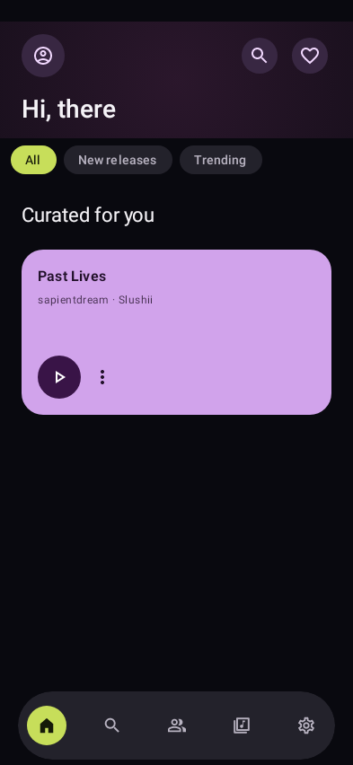
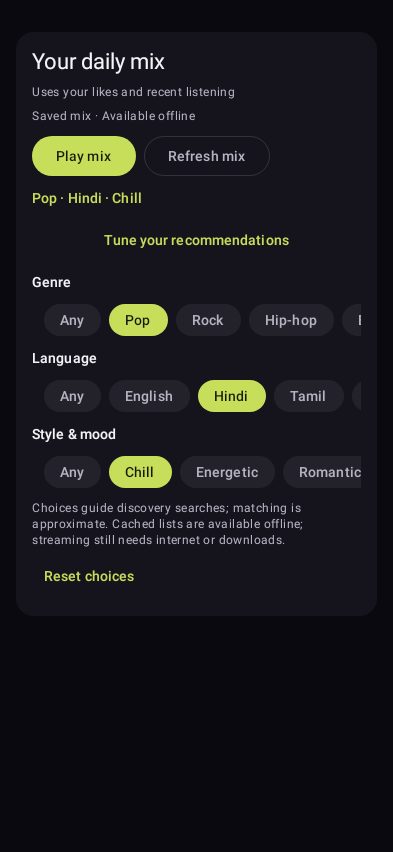

<div align="center">
  

# Mariana

**Your music. Your mood. Your daily mix.**

A personal Android music app with a dark lime interface, Spotify library import,
and cached recommendations tuned to your listening.

[Explore the source](app/src/main/kotlin/com/metrolist/music) · [Build the app](#build-it-yourself) · [Metrolist upstream](https://github.com/MetrolistGroup/Metrolist)

</div>

---

## A look inside

<table>
  <tr>
    <th>Home interface</th>
    <th>Tune your daily mix</th>
  </tr>
  <tr>
    <td align="center"></td>
    <td align="center"></td>
  </tr>
</table>

*These are rendered previews of real app components with sample data, not phone
screenshots. Album art loads from your music in the app. The Home image shows
its visual components rather than the complete current feed.*

## What makes it ours

| Feature | What you get |
| --- | --- |
| Personal daily mix | Discovery from recently liked songs and the most-played tracks from the last 30 days. |
| Choose your tastes | Combine a genre, language, and style or mood. Pick Pop + Hindi + Chill, or leave a category on Any. |
| A small local cache | Up to 48 tracks per mix and 12 saved selections. Current-day results avoid repeated discovery requests. |
| One-tap playback | Play your daily mix, refresh it, or reset your choices from Home. |
| Spotify library import | Import liked-song metadata from JSON or CSV and match it to the playback catalog. |
| Our interface | Dark surfaces, lime controls, lavender discovery cards, rounded covers and floating navigation. |
| Existing music features | Playback, lyrics, library management, downloads and other Metrolist features remain in the source. |

The repository is called **Mariana**. The current Android app label is **My Music**
and its package is `app.personal.mymusic`.

## Daily recommendations

Open **Home → Your daily mix → Tune your recommendations**.

1. Choose a genre, language and style. The option rows scroll horizontally.
2. Tap **Play mix** to listen, or **Refresh mix** to request fresh results.
3. Your choices persist across restarts. **Reset choices** restores Any.

Without filters, Mariana uses liked and recently played music as discovery
seeds, ranks artist overlap, removes duplicate and already-liked discovery
tracks, and limits repetition from a single artist. With filters, it uses your
choices as YouTube Music search hints, including a favorite artist when available.
Genre and language matches are approximate, not verified track labels.

Saved lists are kept in the app's private cache directory. The mix refreshes when you next open Home on a new calendar day, or when
you tap Refresh mix. If discovery fails, a matching saved
list stays available. With no saved list, an unfiltered mix can fall back to
liked or recently listened-to library tracks.

**Cached recommendations are lists, not downloaded audio.** Offline playback
still requires audio already downloaded or cached by the player. Android may
clear recommendation caches when storage is low.

## Bring your Spotify likes

Open **Settings → Spotify Liked Songs**, then choose a supported JSON or
CSV library export. File import does not require Spotify Premium. It transfers
song information and likes; it does not download Spotify audio.

An optional direct Spotify connection uses OAuth PKCE. Availability depends on
your Spotify developer application and account eligibility. The file import
option remains available without that setup.

## Build it yourself

This repository contains source, tests and build configuration. APKs, personal
music exports, local SDK settings and signing keys are excluded.

Requirements: **JDK 21**, an Android SDK with **API 37**, and network access for
Gradle dependencies. The app supports **Android 8.0 or newer**.

On Windows, run from the repository root:

```powershell
./Build-MyMusic.ps1 -JavaPath "C:\path\to\jdk-21" -SdkPath "C:\path\to\android-sdk" -RunTests -Hardened
```

The personal non-debuggable APK is written to:

```text
app/build/outputs/apk/foss/hardened/app-foss-hardened.apk
```

The script creates a local signing key when one is missing. Keep that key
private and retain it for future updates of your builds. A fresh checkout
creates a different certificate from earlier personal APKs, so those APKs
cannot be updated with a newly signed build.

## Privacy and security

Recommendation ranking and preferences run locally. Discovery still contacts
YouTube Music using seed video IDs or search queries, with search-history
recording disabled for those queries. No new analytics service or AI provider
was added for recommendations.

The personal build disables debugging, restricts login navigation, blocks
remote cleartext HTTP, bounds imports and excludes account settings from manual
backups. Recommendation caches contain song metadata rather than login tokens.

The current app source passed **250 unit tests**, both debug and hardened builds,
and component rendering checks. Physical-phone and live-provider testing remain
pending. These checks are not a complete security audit or a guarantee against
malware.

## Built on Metrolist

Mariana is a personal fork of [Metrolist](https://github.com/MetrolistGroup/Metrolist),
based on commit [`76fa5a78`](https://github.com/MetrolistGroup/Metrolist/commit/76fa5a78b5110674442884b6f21c0cef51cdb782).
Credit belongs to the Metrolist team, Mo Agamy, the
[upstream contributors](https://github.com/MetrolistGroup/Metrolist/graphs/contributors)
and the open-source projects they build on. The original project README and its
acknowledgments are preserved in [METROLIST-README.md](METROLIST-README.md).

To track upstream changes in a local checkout:

```bash
git remote add upstream https://github.com/MetrolistGroup/Metrolist.git
git fetch upstream
```

Review changes before merging them into your personal build.

Mariana is independently maintained and is not an official Spotify, YouTube,
Google or Metrolist product. The source remains licensed under
[GNU GPL v3](LICENSE).
